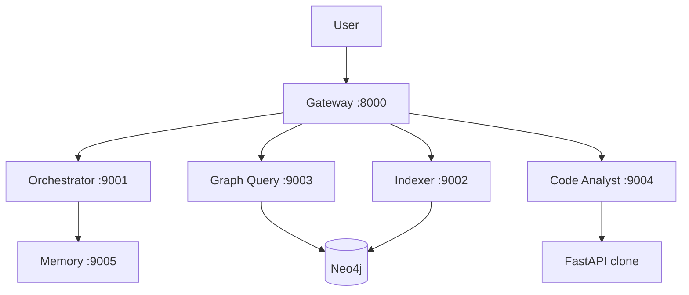

# opsly-assgn

My submission for the FastAPI repo chat assignment: **5 MCP agents**, **Neo4j** for structure, **FastAPI gateway** for HTTP/WS. Spec is in [`ass.md`](ass.md).

**Run it:** [`HOW_TO_USE.md`](HOW_TO_USE.md)  
**Design notes / debugging:** [`docs/ENGINEERING_GUIDE.md`](docs/ENGINEERING_GUIDE.md)



| Agent | Port |
|-------|------|
| Orchestrator | 9001 |
| Indexer | 9002 |
| Graph Query | 9003 |
| Code Analyst | 9004 |
| Memory | 9005 |

```bash
cp .env.example .env
docker compose up --build -d
./scripts/dry_run.sh   # after index (see HOW_TO_USE)
```

```bash
pip install -e ".[dev]"
pytest tests/unit -q
```

Groq is optional — routing/synthesis fall back to rules + templates in `src/opsly/shared/llm.py`.
