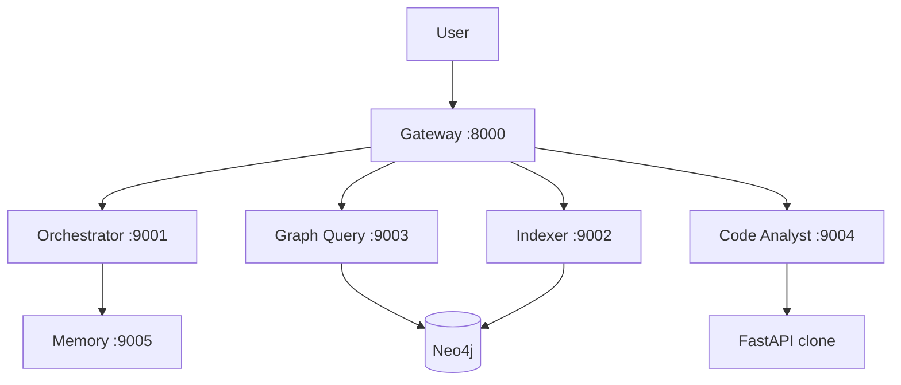

# opsly-assgn — FastAPI Repository Multi-Agent (MCP)

Multi-agent system that answers questions about the [FastAPI](https://github.com/fastapi/fastapi) codebase using **five MCP servers**, a **Neo4j** knowledge graph, and a **FastAPI gateway** ([`ass.md`](ass.md)).

## Start here

**[HOW_TO_USE.md](HOW_TO_USE.md)** — clone, Docker, index, chat, tests, submission checklist.

**[docs/ENGINEERING_GUIDE.md](docs/ENGINEERING_GUIDE.md)** — architecture, end-to-end examples, troubleshooting.

## Architecture (summary)



| Agent | Port |
|-------|------|
| Orchestrator | 9001 |
| Indexer | 9002 |
| Graph Query | 9003 |
| Code Analyst | 9004 |
| Memory | 9005 |

## Quick start

```bash
cp .env.example .env    # set NEO4J_PASSWORD; optional GROQ_API_KEY
docker compose up --build -d
```

Then follow **[HOW_TO_USE.md](HOW_TO_USE.md)** §3–4 (index + chat).

## Tests

```bash
pip install -e ".[dev]"
pytest tests/unit -q
```
