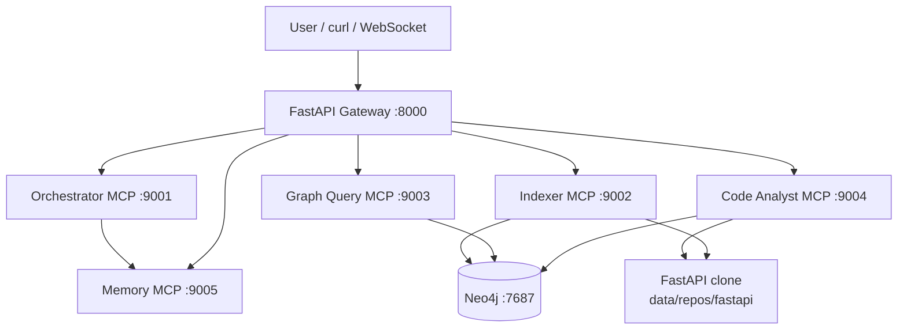
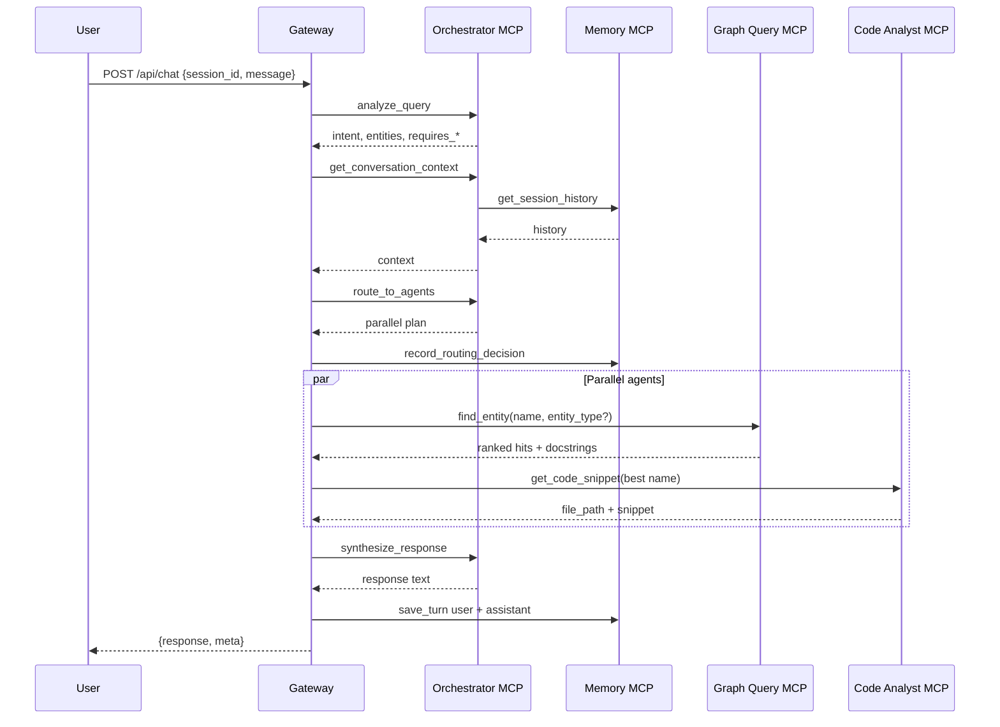

# opsly-assgn — design notes

Notes I wrote while building the assignment: what the spec asked for, how the pieces connect, curl examples, and bugs (MCP streams, Depends ranking in tests, etc.). For “just run it” see [`HOW_TO_USE.md`](../HOW_TO_USE.md).

Related files:

| Document | Role |
|----------|------|
| [`ass.md`](../ass.md) | Official assignment requirements and rubric |
| [`HOW_TO_USE.md`](../HOW_TO_USE.md) | Runbook: Docker, index, chat, submission |
| [`README.md`](../README.md) | Quick start, ports, commands |
| This guide | Narrative + technical depth |

---

## Table of contents

1. [The problem we are solving](#1-the-problem-we-are-solving)
2. [Why this architecture (not one big LLM)](#2-why-this-architecture-not-one-big-llm)
3. [System map at a glance](#3-system-map-at-a-glance)
4. [Core concepts glossary](#4-core-concepts-glossary)
5. [Runtime topology (Docker)](#5-runtime-topology-docker)
6. [The five MCP agents + gateway](#6-the-five-mcp-agents--gateway)
7. [Phase A — indexing the FastAPI repo](#7-phase-a--indexing-the-fastapi-repo)
8. [Phase B — answering a chat question](#8-phase-b--answering-a-chat-question)
9. [Worked example: “Depends docstring” (before vs after)](#9-worked-example-depends-docstring-before-vs-after)
10. [Detailed API examples (end-to-end)](#10-detailed-api-examples-end-to-end)
11. [LLM layer: Groq vs rule-based fallback](#11-llm-layer-groq-vs-rule-based-fallback)
12. [Memory and multi-turn conversations](#12-memory-and-multi-turn-conversations)
13. [MCP client: how the gateway talks to agents](#13-mcp-client-how-the-gateway-talks-to-agents)
14. [Problems we encountered and fixes](#14-problems-we-encountered-and-fixes)
15. [Configuration and environments](#15-configuration-and-environments)
16. [Verification checklist for a new developer](#16-verification-checklist-for-a-new-developer)
17. [Known limitations and intentional trade-offs](#17-known-limitations-and-intentional-trade-offs)
18. [Source code map (where to look first)](#18-source-code-map-where-to-look-first)
19. [Extension ideas (if you continue the project)](#19-extension-ideas-if-you-continue-the-project)

---

## 1. The problem we are solving

### 1.1 User-facing problem

Developers working on or learning from the [FastAPI](https://github.com/fastapi/fastapi) repository need answers that are **grounded in the real codebase**:

- Where is `Depends` defined?
- What is its docstring?
- What imports or depends on a class?
- How do two helpers differ?

A generic chat model can hallucinate file paths or outdated APIs. The assignment asks for a **production-style system** that:

1. **Indexes** the repository into a **knowledge graph** (Neo4j).
2. **Queries** that graph and **reads source files** through specialized agents.
3. **Orchestrates** multiple agents via **MCP** (Model Context Protocol).
4. **Remembers** conversation context per session.
5. Exposes a **FastAPI gateway** for HTTP/WebSocket chat and indexing jobs.

### 1.2 Engineering problem

The rubric is not “call OpenAI once.” It evaluates:

| Area | What reviewers look for |
|------|-------------------------|
| Multi-agent architecture (~35%) | Clear boundaries, MCP tools, orchestration, failure handling |
| Code quality (~25%) | Types, errors, logging, tests |
| Functionality (~25%) | Indexing, graph schema, tool quality, answer relevance |
| Production readiness (~15%) | Docker Compose, config, observability |

So the solution must be **demonstrable**: health checks, index jobs, chat responses with traceable `meta.steps`, and graph statistics—not a single Python script.

---

## 2. Why this architecture (not one big LLM)

### 2.1 Separation of concerns

| Concern | Owner | Why separate |
|---------|--------|--------------|
| Parse repo, write graph | **Indexer** | Heavy, batch-oriented; different scaling and failures than chat |
| Graph traversal, Cypher | **Graph Query** | Security (read-only queries), Neo4j credentials, relationship logic |
| Read files, snippets, AST | **Code Analyst** | Needs repo on disk; different from graph-only lookup |
| Routing + synthesis | **Orchestrator** | Policy layer: which tools run, in what order |
| Session history | **Memory** | Persistence without bloating every agent |
| Public API | **Gateway** | Not an MCP server; HTTP/WS, auth, correlation IDs |

Each agent is an **independent MCP server** (separate process, port, tool surface). That matches the assignment and mirrors how you would split services in a real platform.

### 2.2 Why Neo4j (knowledge graph)

FastAPI is large. Flat full-text search over files misses **structure**:

- Module **CONTAINS** class/function
- **IMPORTS** / **INHERITS_FROM** / **DECORATED_BY**
- **DOCUMENTED_BY** / docstrings on nodes

Neo4j makes “find entity by name” and “trace imports” **first-class**. The assignment explicitly requires this schema family (see [`ass.md`](../ass.md)).

### 2.3 Why MCP

MCP standardizes **tool discovery and invocation** across processes. The gateway and orchestrator use a small **MCP HTTP client** (`src/opsly/mcp_client.py`) instead of ad-hoc REST per agent. Tool names match the assignment (`analyze_query`, `find_entity`, etc.) for grading and demos.

---

## 3. System map at a glance



**Important design choice:** The **gateway executes the orchestration plan** (calls graph + code agents after `route_to_agents`). The orchestrator exposes the required tools; the gateway’s `chat_flow.py` implements parallel agent calls and then calls `synthesize_response`. That keeps one place for HTTP session handling while still showing orchestrator tools in `meta.steps`.

---

## 4. Core concepts glossary

| Term | Meaning in this project |
|------|-------------------------|
| **MCP server** | Process exposing tools over streamable HTTP at `/mcp` |
| **Tool** | Named function (e.g. `find_entity`) callable via MCP |
| **Gateway** | FastAPI app; only entry point for users; MCP **client** |
| **FQN** | Fully qualified name, e.g. `fastapi.param_functions.Depends` |
| **Indexing** | Clone/scan repo → AST parse → MERGE nodes/edges in Neo4j |
| **Session** | `session_id` string; history stored in Memory agent (SQLite) |
| **Intent** | Rule/LLM label: `find`, `explain`, `show`, `compare`, `general` |
| **Synthesis** | Merging `agent_outputs` into one user-facing string |

---

## 5. Runtime topology (Docker)

[`docker-compose.yml`](../docker-compose.yml) defines:

| Service | Port | Purpose |
|---------|------|---------|
| `neo4j` | 7474 (browser), 7687 (bolt) | Graph database |
| `orchestrator` | 9001 | Routing tools + synthesis tool |
| `indexer` | 9002 | Index jobs; mounts `./data` |
| `graph-query` | 9003 | Cypher tools |
| `code-analyst` | 9004 | Snippets; mounts repo under `/data/repos/fastapi` |
| `memory` | 9005 | SQLite at `/data/memory/sessions.db` |
| `gateway` | 8000 | Public API |

**Why one shared `docker/Dockerfile`?** The assignment rubric allows separate images per MCP server; this repo uses **one image, different `command`** per service to reduce maintenance. Each process is still a **separate container** (separate MCP server), which satisfies the spirit of the rubric.

**Why mount `./data`?** So the FastAPI git clone and memory DB survive container restarts on your machine.

**Startup order:** Neo4j healthcheck → agents → gateway. Indexer clones into `data/repos/fastapi` on first full index.

---

## 6. The five MCP agents + gateway

### 6.1 Orchestrator (`src/opsly/agents/orchestrator_server.py`)

**Role:** “Brain” for **classification**, **routing plan**, **memory proxy**, and **final wording**.

| Tool | What it does | Why it exists |
|------|----------------|---------------|
| `analyze_query` | Intent + entities + flags `requires_graph` / `requires_code` | Drives which agents run |
| `route_to_agents` | Returns `{ parallel, sequential, fallback }` | Explicit plan for demo/`meta` |
| `get_conversation_context` | Calls Memory MCP `get_session_history` | Assignment requires orchestrator to use Memory |
| `synthesize_response` | Groq if configured, else `synthesize_template` | Single answer from JSON blobs |

Rule-based analysis lives in [`src/opsly/shared/llm.py`](../src/opsly/shared/llm.py) so the stack works **without** API keys in CI/Docker.

### 6.2 Indexer (`src/opsly/agents/indexer_server.py`)

**Role:** Populate Neo4j from the FastAPI tree.

Typical flow:

1. `index_repository(mode="full"|"incremental")` → job id.
2. Walk Python files under repo path.
3. `parse_python_ast` / internal parser → entities + relations.
4. MERGE into Neo4j (unique constraints on paths/FQNs in [`schema.cypher`](../src/opsly/graph/schema.cypher)).

**Why AST?** Stable structure for classes, functions, imports, docstrings—better than regex-only indexing.

Parser entry: [`src/opsly/graph/parser.py`](../src/opsly/graph/parser.py).

### 6.3 Graph Query (`src/opsly/agents/graph_query_server.py`)

**Role:** Safe, parameterized Cypher.

| Tool | Purpose |
|------|---------|
| `find_entity` | Name/FQN search with ranking (see §9) |
| `get_dependencies` / `get_dependents` | Edge traversal |
| `trace_imports` | Import chain |
| `find_related` | Filter by relationship type |
| `execute_query` | Read-only allowlist (blocks destructive Cypher) |

Implementation: [`src/opsly/graph/neo4j_store.py`](../src/opsly/graph/neo4j_store.py).

### 6.4 Code Analyst (`src/opsly/agents/code_analyst_server.py`)

**Role:** **Disk-backed** understanding—snippets, AST skim, compare.

Service logic: [`src/opsly/services/analyst.py`](../src/opsly/services/analyst.py).

**Why both graph and disk?** Graph gives location + indexed docstring; disk gives **exact source lines** around `def` / `class`. If graph points at tests, a **repo scan** skips `tests/` and finds library definitions.

### 6.5 Memory (`src/opsly/agents/memory_server.py`)

**Role:** Fifth MCP server required by the plan.

- SQLite store (async wrapper) for turns, optional agent result cache, routing audit.
- Orchestrator reads history; gateway writes turns after each chat.

**Why a dedicated agent?** Keeps persistence out of orchestrator state and matches “shared conversation memory” in the assignment.

### 6.6 Gateway (`src/opsly/gateway/main.py`, `chat_flow.py`)

**Role:** External API only.

- `POST /api/chat` — runs [`run_chat`](../src/opsly/gateway/chat_flow.py).
- `POST /api/index` — triggers indexer MCP.
- Health, graph stats, WebSocket, optional SSE streaming.

The gateway is **not** an MCP server; it is the **orchestration executor** and MCP client hub.

---

## 7. Phase A — indexing the FastAPI repo

### 7.1 Why indexing is a separate phase

Chat agents assume the graph already contains nodes for `Function`, `Class`, `Import`, etc. Without indexing, `find_entity` returns empty or stale data and snippets fail.

### 7.2 Steps (operator view)

```bash
docker compose up --build -d
curl -s -X POST http://localhost:8000/api/index \
  -H "Content-Type: application/json" \
  -d '{"mode":"full"}' | python3 -m json.tool
# Copy job_id from the response — do not use the literal string JOB_ID
curl -s "http://localhost:8000/api/index/status/PASTE_JOB_ID_HERE" | python3 -m json.tool
curl -s http://localhost:8000/api/graph/statistics | python3 -m json.tool
```

**Example — start index (shape only; your `job_id` will differ):**

```json
{
  "job_id": "a1b2c3d4-e5f6-7890-abcd-ef1234567890",
  "status": "started",
  "mode": "full"
}
```

**Example — poll until done:**

```json
{
  "job_id": "a1b2c3d4-e5f6-7890-abcd-ef1234567890",
  "status": "completed",
  "files_processed": 412,
  "entities_written": 2785,
  "message": "Indexing finished"
}
```

**Example — graph statistics after a full FastAPI index (approximate counts):**

```json
{
  "nodes_by_label": {
    "File": 380,
    "Module": 380,
    "Function": 920,
    "Class": 210,
    "Import": 1200,
    "Method": 450
  },
  "relationships_by_type": {
    "CONTAINS": 2100,
    "IMPORTS": 980,
    "INHERITS_FROM": 45
  },
  "total_nodes": 2785
}
```

If `total_nodes` is `0` or very small, chat will not find library symbols—you are either on an empty Neo4j instance or indexing has not finished yet.

### 7.3 Steps (system view)

1. Gateway forwards to Indexer MCP `index_repository`.
2. Indexer ensures clone under `FASTAPI_REPO_PATH` (Compose: `/data/repos/fastapi`).
3. For each `.py` file, parser emits entities (File, Module, Class, Function, Import, …) and relations (CONTAINS, IMPORTS, …).
4. Neo4j MERGE upserts by stable keys (`file_path`, `fqn`).
5. Docstrings on functions/classes are stored on nodes when present (`ast.get_docstring`).

**Incremental mode:** Skips full graph wipe; useful for dev re-runs (see README).

### 7.4 Why this matters for answers

Example: after indexing, `find_entity("Depends")` can return:

- `type`: `Function`
- `fqn`: `fastapi.param_functions.Depends`
- `path`: `fastapi/param_functions.py`
- `docstring`: (markdown docstring text)

That node is what enables docstring questions without guessing paths.

---

## 8. Phase B — answering a chat question

### 8.1 Sequence diagram



### 8.2 What appears in `meta` (for demos)

Reviewers can inspect:

- `meta.steps` — orchestrator tools invoked (`analyze_query`, `get_conversation_context`, `route_to_agents`).
- `meta.agent_outputs` — raw graph hits, snippet, optional `docstring` field.

This proves **multi-agent collaboration** even when the user-facing `response` is a short paragraph.

### 8.3 Gateway logic beyond the orchestrator plan

[`chat_flow.py`](../src/opsly/gateway/chat_flow.py) adds practical wiring:

1. **Primary entity** — first entry from `analyze_query.entities` (e.g. `Depends`).
2. **`entity_type`** — if the user says “function” or “class”, pass to `find_entity` to filter Neo4j labels.
3. **Best hit for snippet** — prefer first `Function`/`Class` whose path does **not** start with `tests/`.
4. **Docstring promotion** — copy graph docstring into `agent_outputs["docstring"]` for synthesis.
5. **Fallback explain** — for `explain` intent, optional `explain_implementation` if snippet missing.

**Why gateway does this:** The assignment’s orchestrator tools are the **policy**; the gateway implements **reliable binding** between graph results and code tools (name/path alignment).

---

## 9. Worked example: “Depends docstring” (before vs after)

### 9.1 User request

```json
{
  "session_id": "demo3",
  "message": "Show me the docstring for the Depends function"
}
```

### 9.2 Failure mode (early build)

| Step | What went wrong |
|------|------------------|
| `find_entity` | Broad `CONTAINS` matched many **test imports** (`fastapi.Depends`) |
| `get_code_snippet` | Used first graph hit → snippet from `tests/...`, not library code |
| Entity extraction | Words like **“Show”** treated as entities |
| Synthesis | Template dumped huge JSON into `response` |

Pipeline was **healthy** (good for architecture demo) but **answer quality** was poor.

### 9.3 Fixes (why each)

| Change | Location | Rationale |
|--------|----------|-----------|
| Rank hits: penalize `tests/`, prefer Function/Class, exact name | `neo4j_store._rank_entity_hit` | Users ask about **library** symbols, not test harness names containing “depends” |
| Return `docstring` on graph rows | `find_entity` Cypher | Docstring questions should not require a separate DB round-trip |
| Skip tests in repo scan | `analyst._scan_repo_for_def` | When graph is noisy, still locate `def Depends` under `fastapi/` |
| Snippet uses best non-test graph hit | `chat_flow.py` | Aligns code analyst with ranked graph |
| Stopword filter for entities | `llm.extract_entities` | “Show me the …” → entity `Depends` only |
| Docstring-aware template | `synthesize_template` | Readable markdown without Groq |

### 9.4 Success mode (current)

- **`response`:** `**Depends** (`fastapi/param_functions.py`)` + full docstring + example.
- **`graph_find_entity[0]`:** `fastapi.param_functions.Depends` with docstring populated.
- **`code_snippet`:** Lines around `def Depends` in `param_functions.py`.

Optional note: `intent` may still show `"explain"` in metadata because rule order checks “explain/how” before “docstring/show”; routing still sets `requires_code` and `requires_graph` correctly for this question. Tuning intent to `"show"` when `docstring` appears is a cosmetic metadata improvement only.

### 9.5 Step-by-step: one request through every layer

This traces the **same** question a reviewer might ask in a demo, naming **which process** handles each step and **what data** crosses the wire.

**Command:**

```bash
curl -s -X POST http://localhost:8000/api/chat \
  -H "Content-Type: application/json" \
  -d '{"session_id":"demo3","message":"Show me the docstring for the Depends function"}' \
  | python3 -m json.tool
```

| Step | Component | Action | Result (conceptual) |
|------|-----------|--------|---------------------|
| 1 | Gateway | Receives HTTP POST, reads `session_id` + `message` | Starts `run_chat()` |
| 2 | Gateway → Orchestrator MCP | Tool `analyze_query` | See JSON below |
| 3 | Gateway → Orchestrator MCP | Tool `get_conversation_context` | Orchestrator → Memory MCP → empty history for new session |
| 4 | Gateway → Orchestrator MCP | Tool `route_to_agents` | Plan: parallel `find_entity` + `get_code_snippet` |
| 5 | Gateway → Memory MCP | Tool `record_routing_decision` | Audit row in SQLite |
| 6 | Gateway → Graph Query MCP | Tool `find_entity` with `name=Depends`, `entity_type=Function` | Ranked list; #1 is library `Depends` |
| 7 | Gateway → Code Analyst MCP | Tool `get_code_snippet` with `name=Depends` (after picking non-test hit) | Snippet from `fastapi/param_functions.py` |
| 8 | Gateway → Orchestrator MCP | Tool `synthesize_response` | Markdown answer (template or Groq) |
| 9 | Gateway → Memory MCP | `save_turn` × 2 | User + assistant messages stored |
| 10 | Gateway | HTTP 200 JSON body | `response` + `meta` returned |

**Step 2 — typical `analyze_query` output (from `meta.steps[0]`):**

```json
{
  "intent": "explain",
  "entities": ["Depends"],
  "requires_graph": true,
  "requires_code": true,
  "session_id": "demo3"
}
```

How the rules got there ([`llm.py`](../src/opsly/shared/llm.py)):

- Regex entities: `Depends` matches the FastAPI keyword list; **Show** is filtered as a stopword.
- `requires_graph` / `requires_code` are true because intent is treated like an explain/show-style question that needs symbol lookup + source.

**Step 4 — typical routing plan (`meta.steps[2]`):**

```json
{
  "parallel": [
    { "agent": "graph_query", "tool": "find_entity", "arg_key": "name" },
    { "agent": "code_analyst", "tool": "get_code_snippet", "arg_key": "name" }
  ],
  "sequential": [],
  "fallback": [{ "agent": "graph_query", "tool": "find_entity" }]
}
```

**Step 6 — what Graph Query actually runs:**

- Cypher matches nodes where name/FQN relates to `"Depends"`, optionally label `Function`.
- Up to 80 rows fetched, then **sorted in Python** by `_rank_entity_hit`:
  - `tests/` paths get a large penalty.
  - `Function` / `Class` beat `Import`.
  - Exact name `Depends` beats substring names like `router_ws_depends_err`.
- Top 15 returned; **first row** is the one the gateway prefers for docstring + snippet binding.

**Step 6 — first hit (what you want reviewers to see):**

```json
{
  "type": "Function",
  "fqn": "fastapi.param_functions.Depends",
  "name": "Depends",
  "path": "fastapi/param_functions.py",
  "docstring": "Declare a FastAPI dependency.\n\nIt takes a single \"dependable\" callable..."
}
```

**Step 7 — code analyst behavior:**

1. Calls the same ranked `find_entity` internally to resolve `path`.
2. Opens `/data/repos/fastapi/fastapi/param_functions.py` on disk.
3. Finds the line matching `def Depends`.
4. Returns ~25 lines of context (parameters, `Doc(...)` blocks, etc.).

**Step 8 — synthesis without Groq:**

`synthesize_template` sees `"docstring"` in the user message, reads `agent_outputs["docstring"]`, and formats:

```markdown
**Depends** (`fastapi/param_functions.py`)

Declare a FastAPI dependency.
...
```

That string becomes the top-level `"response"` field—not the raw `meta` blob.

### 9.6 Before vs after (same question, different outcomes)

| Field | Broken build (`demo2`) | Fixed build (`demo3`) |
|-------|------------------------|------------------------|
| `entities` | `["Depends", "Show"]` | `["Depends"]` |
| `graph_find_entity[0].type` | `Import` | `Function` |
| `graph_find_entity[0].path` | `tests/test_union_form_normalization.py` | `fastapi/param_functions.py` |
| `code_snippet.file_path` | `tests/...` | `fastapi/param_functions.py` |
| `response` | `"Answer for: ..."` + huge JSON | Markdown docstring + example |
| Proof multi-agent works? | Yes (`meta.steps` OK) | Yes, **and** answer is correct |

---

## 10. Detailed API examples (end-to-end)

Copy-paste these after `docker compose up --build` and a **completed** full index. Replace placeholders where noted.

### Example A — Agent and infrastructure health

```bash
curl -s http://localhost:8000/api/agents/health | python3 -m json.tool
```

**What to explain to a new teammate:** The gateway does **not** assume agents are up. It MCP-pings each URL (orchestrator, indexer, graph-query, code-analyst, memory) and checks Neo4j connectivity.

**Typical healthy response (shape):**

```json
{
  "status": "ok",
  "gateway": "up",
  "neo4j": "up",
  "agents": {
    "orchestrator": { "status": "up", "url": "http://orchestrator:9001/mcp" },
    "indexer": { "status": "up", "url": "http://indexer:9002/mcp" },
    "graph_query": { "status": "up", "url": "http://graph-query:9003/mcp" },
    "code_analyst": { "status": "up", "url": "http://code-analyst:9004/mcp" },
    "memory": { "status": "up", "url": "http://memory:9005/mcp" }
  }
}
```

If any agent is `"down"`, fix MCP/network first (see §13)—indexing and chat will fail even with a full graph.

---

### Example B — “What is the FastAPI class?” (find + explain)

```bash
curl -s -X POST http://localhost:8000/api/chat \
  -H "Content-Type: application/json" \
  -d '{"session_id":"demo-class","message":"What is the FastAPI class?"}' \
  | python3 -m json.tool
```

**Expected orchestration:**

| Tool | Why |
|------|-----|
| `analyze_query` | Entities include `FastAPI`; intent often `find` or `general` |
| `find_entity` | Locates class `FastAPI` in `fastapi/applications.py` (or similar) |
| `get_code_snippet` | Shows `class FastAPI` constructor region |

**What to look for in `meta.agent_outputs`:**

- `graph_find_entity[0].type` → `"Class"`
- `graph_find_entity[0].fqn` → something like `fastapi.applications.FastAPI`
- `code_snippet.snippet` → contains `class FastAPI`

**User-facing `response`:** With template fallback, may summarize class location + excerpt; with Groq, a short prose explanation citing the path.

---

### Example C — Compare two parameters (`Path` vs `Query`)

```bash
curl -s -X POST http://localhost:8000/api/chat \
  -H "Content-Type: application/json" \
  -d '{"session_id":"demo-compare","message":"Compare Path and Query parameters in FastAPI"}' \
  | python3 -m json.tool
```

**Expected orchestration:**

| `analyze_query` | `route_to_agents` extras |
|-----------------|---------------------------|
| `intent`: `"compare"` | Parallel snippet for entities; may add `compare_implementations` |
| `entities`: `["Path", "Query"]` (order from regex) | |

**Gateway behavior** ([`chat_flow.py`](../src/opsly/gateway/chat_flow.py)): for compare intent, may call `compare_implementations` with `entity_a` / `entity_b` from the entity list (defaults pad with `Path`/`Query` if missing).

**Typical `agent_outputs` keys:**

```json
{
  "graph_find_entity": [ "..." ],
  "code_snippet": { "name": "Path", "file_path": "fastapi/param_functions.py", "snippet": "..." },
  "compare": {
    "entity_a": { "name": "Path", "file_path": "...", "snippet": "..." },
    "entity_b": { "name": "Query", "file_path": "...", "snippet": "..." },
    "note": "Compare parameter handling..."
  }
}
```

**Teaching point:** Compare queries are **inherently multi-entity**; the orchestrator plan exposes that in `meta` even when the final `response` is still template-driven without Groq.

---

### Example D — Multi-turn session (memory)

Turn 1 — establish context:

```bash
curl -s -X POST http://localhost:8000/api/chat \
  -H "Content-Type: application/json" \
  -d '{"session_id":"demo-memory","message":"Show me the docstring for Depends"}' \
  | python3 -m json.tool
```

Turn 2 — same `session_id`:

```bash
curl -s -X POST http://localhost:8000/api/chat \
  -H "Content-Type: application/json" \
  -d '{"session_id":"demo-memory","message":"What file is that defined in?"}' \
  | python3 -m json.tool
```

**What happens on turn 2:**

1. `get_conversation_context` returns turn 1 user + assistant text from Memory MCP.
2. `analyze_query` may **not** extract a strong entity from “that” (limitation—see §12).
3. You may still get a useful answer if the user names `Depends` again, or if Groq uses history.

**What to show reviewers:** After turn 1, `meta.steps[1].result.history` is `[]` on turn 1; on turn 2, history is **non-empty** (proves Memory agent + orchestrator tool). Improving follow-up quality is an extension (§19).

---

### Example E — Streaming chat (SSE)

```bash
curl -s -N -X POST http://localhost:8000/api/chat \
  -H "Content-Type: application/json" \
  -d '{"session_id":"demo-stream","message":"What is APIRouter?","stream":true}'
```

Events typically include `agent_start`, `agent_done` (with full `meta`), and `final` with `response`. Useful for UI demos; same pipeline as non-streaming.

---

### Example F — WebSocket (interactive clients)

Connect to `ws://localhost:8000/ws/chat`, send:

```json
{"session_id": "demo-ws", "message": "Find HTTPException in the codebase"}
```

Same orchestration as HTTP; transport differs only at the gateway.

---

### Example G — Indexing a mental model (one file)

You do not need to call this for the demo, but it helps new developers understand **what indexing writes**.

For a hypothetical file `fastapi/param_functions.py` containing `def Depends(...)`:

```text
(File:path)─[:CONTAINS]→(Module:fqn)
(Module)─[:CONTAINS]→(Function:Depends)
(Function)─[:DOCUMENTED_BY]→(Docstring)   # when parser captured docstring
(Module)─[:IMPORTS]→(Import:typing.Annotated)
```

When the user asks about `Depends`, **Graph Query** finds the `Function` node (ranked first), and **Code Analyst** uses `file_path` + line scan to return live source—including nested `Doc()` strings that may not match the graph docstring field exactly.

---

### Example H — Calling graph tools directly (advanced debug)

Agents are MCP-only in production, but developers can reason about equivalents:

| User question | Graph tool that would answer it | Code tool |
|---------------|----------------------------------|-----------|
| “Who imports X?” | `get_dependents` / `trace_imports` | — |
| “What does X inherit?” | `get_dependencies` with `INHERITS_FROM` | — |
| “Show me X’s code” | `find_entity` (location) | `get_code_snippet` |
| “Explain X” | `find_entity` | `explain_implementation` |

The **gateway chat path** today wires the most common pair: `find_entity` + `get_code_snippet` + synthesis. Deeper graph tools are available on Graph Query MCP for future routing rules.

---

## 11. LLM layer: Groq vs rule-based fallback

### 11.1 Design goal

**The system must run with zero LLM keys** (Docker demo, CI, reviewers). Graph + templates still produce useful answers.

### 11.2 When Groq is configured

Set `GROQ_API_KEY` in `.env` (and pass through Compose for gateway + orchestrator).

| Stage | Groq usage |
|-------|------------|
| `analyze_query` | Optional hint appended as `llm_hint` |
| `synthesize_response` | Primary natural-language answer |

Models are tried from config/env ([`env_loader.py`](../src/opsly/env_loader.py)); account-specific model availability may require switching models (e.g. Qwen vs Llama).

### 11.3 When Groq is absent

| Stage | Fallback |
|-------|----------|
| Analysis | `analyze_query_rules` |
| Routing | `route_to_agents_rules` |
| Synthesis | `synthesize_template` (docstring/class-aware) |

**Why templates for docstrings:** Structured fields (`docstring`, `file_path`, `name`) map directly to markdown—no hallucination risk.

---

## 12. Memory and multi-turn conversations

### 12.1 Flow

1. Before agents run, orchestrator `get_conversation_context` loads last N turns from Memory.
2. After synthesis, gateway `save_turn` for user message and assistant reply.
3. `record_routing_decision` stores the plan JSON for auditing.

### 12.2 Current limitation (honest)

Follow-up resolution (“What file was that in?”) depends on synthesis/context use in prompts. History is **stored** and returned in `get_conversation_context`; deeper **coreference** (binding “that” to last entity) is an extension point—see §19.

---

## 13. MCP client: how the gateway talks to agents

File: [`src/opsly/mcp_client.py`](../src/opsly/mcp_client.py).

1. Open **streamable HTTP** session to `http://<service>:<port>/mcp`.
2. `initialize` → `call_tool(name, args)`.
3. Parse structured or text JSON from tool result.

### 13.1 Bug we fixed (all agents “down”)

**Symptoms:** Health check failed; MCP calls raised `ExceptionGroup`; tools never returned.

**Causes:**

1. Streamable HTTP client yields **two** streams `(read, write)`; code assumed **three**.
2. Error flag checked as `isError` instead of MCP SDK’s **`is_error`**.

**Why it mattered:** Every gateway → agent call failed at the transport layer—indexing and chat could not work regardless of Neo4j or graph quality.

**Fix:** Align with SDK contract; flatten `ExceptionGroup` messages for logs.

After code changes: **`docker compose up --build`** so containers pick up the client fix.

---

## 14. Problems we encountered and fixes

| # | Problem | Symptom | Root cause | Fix / mitigation |
|---|---------|---------|------------|------------------|
| 1 | MCP transport | All agents unhealthy | Wrong stream unpack + `isError` | Fix `mcp_client.py`, rebuild |
| 2 | Local env | dotenv parse failures on `keys.txt` | Embedded Python in file | Custom parser in `env_loader.py` |
| 3 | Index status 404 | `JOB_ID` literal in URL | Placeholder not replaced | Use UUID from `POST /api/index` response |
| 4 | Poor Depends answer | Test imports + JSON dump | Ranking + synthesis + snippet binding | §9.3 |
| 5 | Aura vs Compose Neo4j | Confusing empty graph | Two different URIs | One env per run: local Compose **or** Aura consistently |
| 6 | Groq model 404 | Synthesis falls back silently | Account model access | Configure working model list in env |

---

## 15. Configuration and environments

Copy [`.env.example`](../.env.example) to `.env`.

| Variable | Typical use |
|----------|-------------|
| `NEO4J_PASSWORD` | Compose Neo4j auth |
| `NEO4J_URI`, `NEO4J_USER` | Local dev or Aura |
| `GROQ_API_KEY` | Optional LLM |
| `FASTAPI_REPO_PATH` | Host vs container path to clone |
| `MCP_*_URL` | Gateway → agent URLs (set automatically in Compose) |
| `MEMORY_DB_PATH` | SQLite file for sessions |

**Local without full Compose:** Run agents via CLI entrypoints listed in README (orchestrator, indexer, etc.) with Neo4j reachable.

---

## 16. Verification checklist for a new developer

Do these in order on a fresh clone:

1. **Environment**
   - `python3.12 -m venv .venv && source .venv/bin/activate`
   - `pip install -e ".[dev]"`

2. **Docker stack**
   - `docker compose up --build -d`
   - `curl -s http://localhost:8000/api/agents/health | python3 -m json.tool`  
     Expect: gateway ok, agents up, neo4j up.

3. **Index**
   - `POST /api/index` with `{"mode":"full"}`
   - Poll status until completed.
   - `GET /api/graph/statistics` — node counts in thousands after full FastAPI index.

4. **Chat (architecture)**
   - POST `/api/chat` with a simple question; confirm `meta.steps` lists orchestrator tools.

5. **Chat (quality)**
   - Docstring query for `Depends` — expect `fastapi/param_functions.py` (§9.4).

6. **Tests**
   - `pytest tests/unit -q`

7. **Optional LLM**
   - Add `GROQ_API_KEY`, rebuild orchestrator + gateway, repeat chat for richer prose on compare/explain questions.

---

## 17. Known limitations and intentional trade-offs

| Topic | Limitation | Why accepted |
|-------|------------|--------------|
| CALLS / DEPENDS_ON | Partial static analysis | Full call graph is hard; IMPORTS/CONTAINS dominate for demo |
| Index time | First full index is slow | Real repo size; use job polling |
| Single Dockerfile | Not one file per agent image | Simpler assignment repo; processes still isolated |
| Intent metadata | “docstring” query may show `explain` | Routing flags still correct |
| Graph noise | Test functions with “depends” in name may appear lower in list | Ranking puts library `Depends` first |
| Context | History stored; weak anaphora | Scope for future orchestrator prompt work |
| Coverage | Unit tests focus on core logic | Agent entrypoints often omitted from coverage config |

---

## 18. Source code map (where to look first)

```
opsly-assgn/
├── ass.md, HOW_TO_USE.md    # Requirements + runbook
├── docker-compose.yml       # Runtime wiring
├── docker/Dockerfile        # Shared image
├── docs/ENGINEERING_GUIDE.md  # This file
├── src/opsly/
│   ├── gateway/
│   │   ├── main.py          # HTTP routes, health, index proxy
│   │   └── chat_flow.py     # Multi-agent chat pipeline
│   ├── agents/
│   │   ├── orchestrator_server.py
│   │   ├── indexer_server.py
│   │   ├── graph_query_server.py
│   │   ├── code_analyst_server.py
│   │   ├── memory_server.py
│   │   └── _runner.py       # MCP HTTP server bootstrap
│   ├── graph/
│   │   ├── parser.py        # AST → entities/relations
│   │   ├── neo4j_store.py   # Cypher + find_entity ranking
│   │   └── schema.cypher    # Constraints
│   ├── services/analyst.py  # Snippets, compare, patterns
│   ├── memory/              # SQLite session store
│   ├── shared/
│   │   ├── config.py        # Pydantic settings
│   │   ├── llm.py           # Rules + Groq + templates
│   │   └── exceptions.py
│   ├── mcp_client.py        # MCP HTTP client
│   └── env_loader.py        # .env + keys.txt
├── tests/unit/              # pytest
└── data/
    ├── repos/fastapi/       # Cloned target repo (after index)
    └── memory/sessions.db   # Created at runtime
```

---

## 19. Extension ideas (if you continue the project)

1. **Intent fix** — If message contains `docstring`, force `intent: show` in `analyze_query_rules`.
2. **Orchestrator-owned execution** — Move parallel MCP calls from gateway into orchestrator tool `execute_plan` (closer to diagram in `ass.md`).
3. **Use history in synthesis** — Pass last assistant entity into `find_entity` for follow-ups.
4. **Separate Dockerfiles** — One Dockerfile per MCP service for production readiness points.
5. **Pre-seeded graph** — Ship a small dump so `compose up` works before first index completes.
6. **Coverage** — Integration tests with testcontainers Neo4j + mocked MCP.
7. **Filter test nodes in Cypher** — Optional `exclude_tests=true` on `find_entity` for cleaner `meta`.

---

## Quick reference — one-page mental model

1. **Index once** → Neo4j knows files, symbols, docstrings, imports.  
2. **User asks** → Gateway asks Orchestrator *what* to run.  
3. **Gateway runs** Graph Query + Code Analyst in parallel.  
4. **Orchestrator synthesizes** (LLM or template).  
5. **Memory saves** the turn for the session id.

The system is “correct” when health passes, graph stats look populated, and chat returns **grounded** paths like `fastapi/param_functions.py`—not when it merely returns JSON from test files.

For commands and ports only, use [`README.md`](../README.md). For grading criteria, use [`ass.md`](../ass.md).
